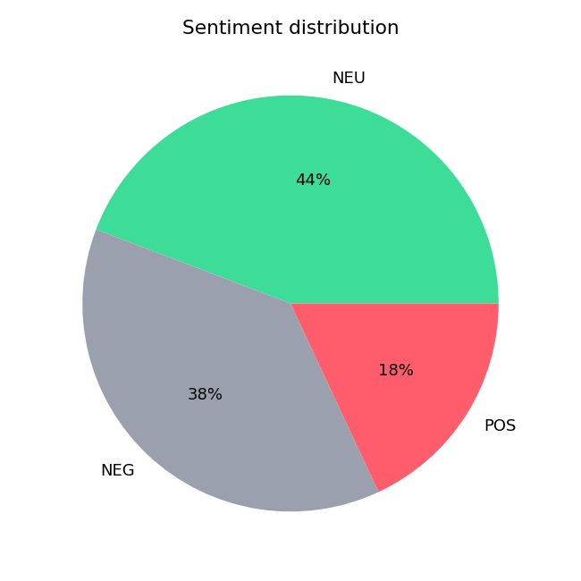
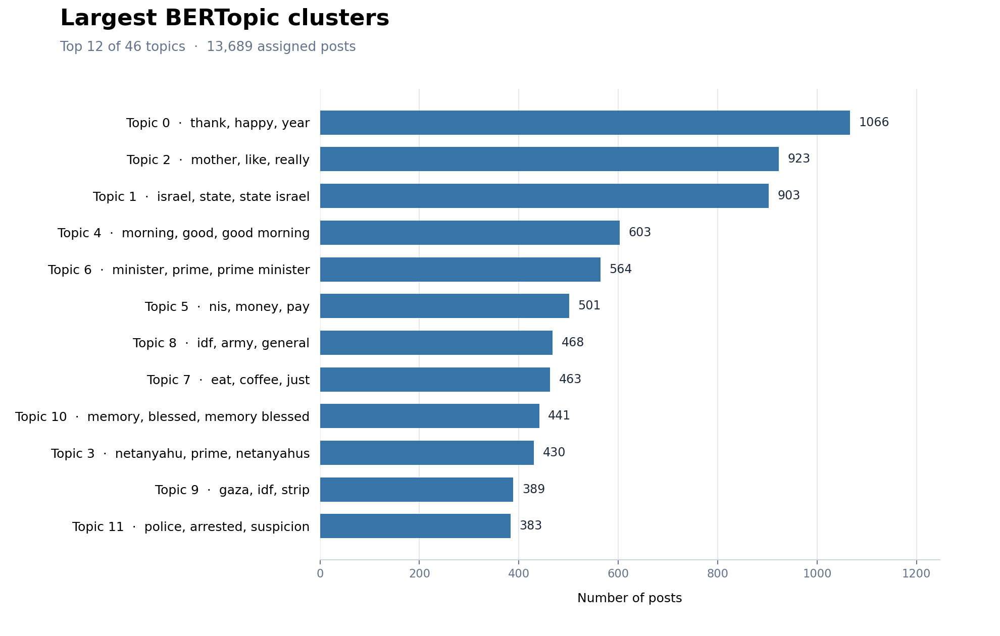

# Judicial Reform Discourse on X (Twitter)

**Final-year Computer Science project, SCE — 2026**  
Edgar Abramov & Shelly Goldman  
Supervisor: Dr. Aviad Elyashar

Our project examines the discussion surrounding the 2023 Israeli judicial reform on X. We worked on two related problems: finding accounts that were relevant to the discussion, and analyzing what those accounts posted over time.

We started with a list of people and organizations connected to the reform, expanded it using their follower/following networks, and trained classifiers to identify relevant accounts. We then collected a sample of timelines and used NLP models to study sentiment, emotion, and recurring topics.

## What we did

**1. Finding accounts.** We extracted links from three Hebrew Wikipedia pages about the reform and added members of the 25th Knesset. After reviewing the entities and matching X accounts, our list contained 412 relevant people and organizations, including 295 entries with X accounts.

**2. Building a candidate pool.** We collected follower/following connections for the identified accounts and consolidated them into 15,747 unique candidate usernames.

**3. Classifying users.** We manually labeled an initial set of 100 accounts. We compared models including logistic regression, random forest, SVM, decision trees, AdaBoost, and XGBoost, using profile text and numeric account features. With active learning, we selected uncertain accounts for two more labeling rounds, reaching 300 labeled accounts in total.

**4. Selecting the target population.** At a confidence threshold of 0.80, the final model selected 1,718 candidate accounts. A manual check of 40 randomly sampled predictions found 37 relevant accounts (92.5% in that small sample).

**5. Analyzing posts.** From 150 sampled accounts, we obtained 94 usable timelines. The resulting corpus contained 15,858 nonempty posts. We translated posts for English-language NLP models, ran sentiment and emotion analysis, and used BERTopic to identify 46 topics.

## Results

| Measure | Result |
| --- | ---: |
| Relevant entities | 412 |
| Unique candidate accounts | 15,747 |
| Accounts labeled during active learning | 300 |
| Predicted relevant accounts (confidence ≥ 0.80) | 1,718 |
| Usable timelines | 94 |
| Nonempty posts analyzed | 15,858 |
| BERTopic topics | 46 |

According to the sentiment model, 44.2% of posts were neutral, 37.7% negative, and 18.0% positive.



The 12 largest topics from the final BERTopic results are shown below. The keywords are generated by the model and are not manually assigned political labels.



We also tracked performance across the three active-learning rounds:


## Code and tools

The project was written in **Python**, with pandas and NumPy for data processing, scikit-learn and XGBoost for classification, PySentimiento for sentiment/emotion analysis, and BERTopic (with UMAP and HDBSCAN) for topic modeling. We used Selenium-based tools during data collection and Matplotlib/Seaborn for figures.

The repository follows the main stages of our work:

| Folder | Contents |
| --- | --- |
| `POIs/` | Wikipedia extraction, entity matching, metadata, statistics |
| `Candidates/` | Follower/following candidate processing |
| `Classification/` | Label processing and class statistics |
| `Active Learning/` | Model comparison, uncertainty sampling, confidence thresholds |
| `Analysis/` | Timeline processing, translation, sentiment, emotion, topics |
| `docs/` | Final report and reproduction notes |

## Running the code

Install the dependencies in a Python virtual environment:

```bash
python -m venv .venv
# Activate it first (on Windows PowerShell: .venv\Scripts\Activate.ps1)
python -m pip install -r requirements.txt
```

Each stage has its own scripts and input files; there is no single command to run the complete project. The original account-level CSV files and third-party scrapers are not included in this public version, so most stages require authorized input data before they can run. The dependencies are listed for reference, but the exact versions used in our original experiments were not preserved.

See [reproduction notes](docs/REPRODUCIBILITY.md) for the file requirements and script order, or read the [final project report](docs/Final_Project_Report.pdf) for the full methodology and analysis.

## Scope

Our classification task was to identify accounts **relevant to the reform discussion**. We did **not** classify accounts as supporters or opponents of the reform. That would require a separate stance-labeling and modeling stage.

The 92.5% validation result is based on only 40 reviewed accounts, and the timeline sample does not represent every account in the predicted target population. Translated text can also affect NLP results. These limitations and possible next steps are discussed in the report.
